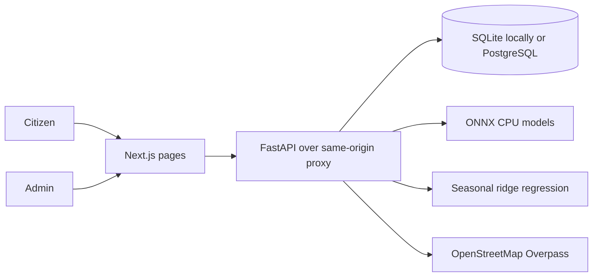

# Architecture

Next.js serves the interface. TypeScript catches inconsistent component and API types. Tailwind and the shared button and theme tokens keep the interface consistent. Leaflet displays geographic results and Framer Motion animates impact cards.

FastAPI checks roles and validates inputs. SQLAlchemy talks to the database and Alembic applies schema changes. An opaque cookie represents a session. Passwords use salted scrypt. Google sign-in verifies the signed credential on the server.

The scanner decodes a photo, applies its orientation and downsizes it. ONNX Runtime runs region proposals and predicts material on the resulting crops. The server saves detections and optional corrections. A confirmed weight creates a factor snapshot so estimates can be explained later.

Municipal summaries aggregate the stored snapshots. The forecast uses separate seasonal curves for six simulated wards. It does not read citizen activity. [Forecast method](docs/forecast-method.md)
