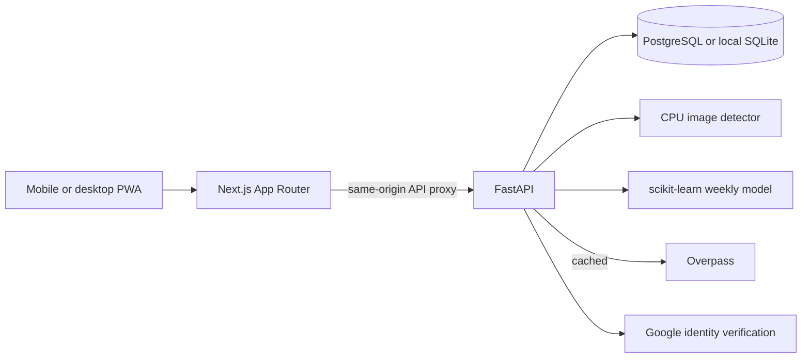

# EcoCycle AI implementation plan

## Architecture

## Folders and data

The root contains deployment, verification and setup commands. `web/` contains routes, design tokens, components and public assets. `backend/` holds the API, migrations, model assets, training scripts and tests. `docs/` holds screenshots and evidence.

Users own expiring sessions, scan predictions, material records and corrections. Each saved material record keeps its original weight, factors and impact. Centers carry coordinates, accepted materials and provenance. The forecast combines open observations with labeled simulated ward allocations. Audit entries record privileged changes.

## API surface

Auth register, login, logout, current session and Google identity. Scan inference, confirm, history and correction. Material factors and impact summaries. Nearby centers and admin center CRUD. Municipality aggregates, forecasts, model metrics, report downloads, feedback review, model refresh and audit history. FastAPI generates the authoritative endpoint and schema list at /docs.

## Milestone gates

1. M1 — Scaffold, design tokens and components, schema migrations, session auth, CI.
2. M2 — Real CPU vision inference, validation, evaluation and saved corrections.
3. M3 — Versioned factors, estimates, history and citizen dashboard.
4. M4 — Cached live facility search, seeded fallback, map and directions.
5. M5 — Train and test weekly forecast, municipal analytics and exports.
6. M6 — Administration, hardening, accessibility preferences, PWA.
7. M7 — Integration, mobile and end-to-end checks, fix regressions.
8. M8 — Seed, student guide, deployment, clean checkout verification.

Run lint, type checks, tests and a production build before each milestone commit. Record actual outcomes and unresolved external dependencies.

## Risks

Waste labels vary by dataset. Household photos can differ from training examples. Scrap rates vary by buyer. Carbon and energy factors depend on the material and comparison process. Live recycling listings can be incomplete. Small ward histories limit forecast validity. OAuth, hosted databases and mobile camera access require deployment configuration.

## Assumptions

- Use Bengaluru as the initial municipality, INR and kilograms. Demo records live in explicitly identified demo accounts.
- Record estimated benefits when a citizen confirms a material record. Physical recycling is self-reported.
- Use opaque HTTP-only cookie sessions and same-origin API proxying. Admin accounts are provisioned outside public signup.
- Use the requested Next.js and FastAPI deployment targets. Prepare Vercel and Render configuration when provider credentials are unavailable.
- Work in the supplied empty project directory and use repository-local development tooling.

## Deviations

Record specific fallbacks and limits here as they are measured.

- Overpass can fail or omit material tags. The locator displays explicitly synthetic local sample points in demo mode.
- The shipped two-stage scanner performs substantially better on close-up test photos than on a small annotated street-image sample. See MODEL_CARD.md.
- Forecast ward allocations are simulated from Austin history; verified local Bengaluru waste measurements were unavailable.
- Playwright used locally installed Brave. Deployment, provider OAuth, physical-device camera and Lighthouse targets remain outside this verification run.
