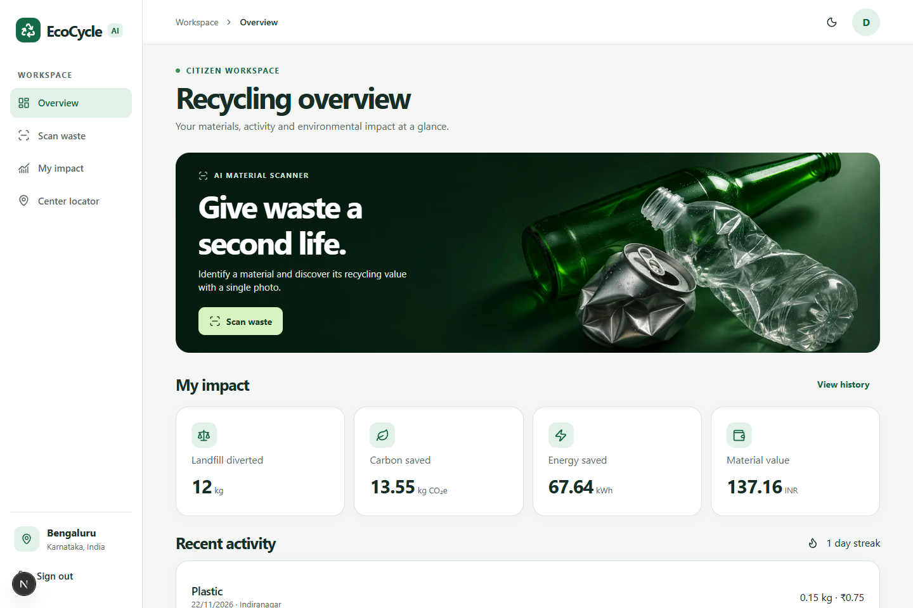
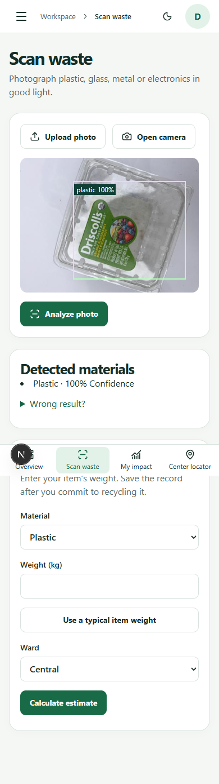

# EcoCycle AI

Identify everyday non-biodegradable waste, estimate material value and recycling impact, and find collection points. Municipality administrators can review activity, export reports and explore weekly waste scenarios.

## Local setup

For Windows laptop setup, demo logins, and an offline walkthrough, see [the local demo guide](LOCAL_DEMO.md).

Install Node.js 24, pnpm 11 and uv. From the project root, run:

```sh
node scripts/setup.mjs
node scripts/dev.mjs
```

Open http://localhost:3000. Create a citizen account or sign in as `citizen@example.org` with `EcoCycle local demo 2026!`. The local municipality account uses `admin@example.org` with the same demo password. Demo records represent simulated activity. Production disables demo-account seeding.

Upload [the real test photo](backend/vision_assets/demo-plastic.jpg) from the **Scan waste** tab. API documentation is served at http://localhost:3000/api/docs.

## Verify and retrain

```sh
node scripts/check.mjs
pnpm --dir web exec playwright install chromium
pnpm --dir web run e2e
node scripts/retrain.mjs
```

See [deployment](DEPLOY.md), [model card](MODEL_CARD.md) and [the five-minute demo](DEMO_SCRIPT.md).

## Screenshots




